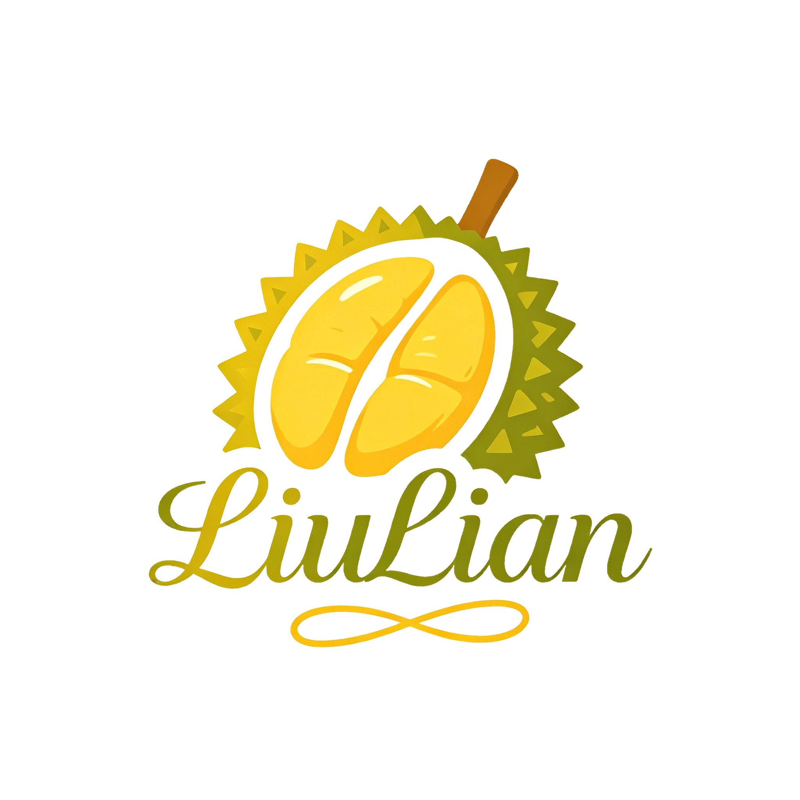

# **Liulian Plugin**

[中文](README.md) | [English](README_EN.md)   

### **Description**
* `liulian-plugin` is a Yunzai-Bot plugin that provides extended features such as Genshin Impact underground maps, Bilibili push notifications, and plugin management, plus group chat features including Genshin/Star Rail character guessing, marry group members, Liulian AI, random expressions, constellation fortune, chat statistics, weather, multi-group broadcast messages, and group muting. See `说明.txt` for more features and details. Some features can be configured via `#榴莲设置` or feature-specific settings.
* ⚠ Since I am not familiar with Neverness to Everness and Wuthering Waves characters, please PR if you find issues (such as wrong character names / missing aliases, etc.)

### **Installation (Git, Recommended)**
Place liulian-plugin in the plugins directory of Yunzai-Bot, restart Yunzai-Bot, and it is ready to use.
Please install with git for easy future upgrades. Open a terminal in the Yunzai-Bot root directory and run one of the following commands:

#### Install via Gitee
```
git clone https://gitee.com/huifeidemangguomao/liulian-plugin.git ./plugins/liulian-plugin/
pnpm install -P
``` 

#### Install via GitHub  
```
git clone https://github.com/flyingmangocat/liulian-plugin.git ./plugins/liulian-plugin/
pnpm install -P
```

#### Install via GitCode  
```
git clone https://gitcode.com/huifeidemangguomao/liulian-plugin.git ./plugins/liulian-plugin/
pnpm install -P
```
 
### **Contributors**
| Nickname                                                     | Contribution                        |
| :----------------------------------------------------------: | ----------------------------------- |
|[提瓦特图研所](https://m.bilibili.com/space/1872522256) | Genshin Impact underground map source |
|[喵喵](https://gitee.com/yoimiya-kokomi) | Framework support |
|[Yi0086](https://gitee.com/yi0086) | Technical support |
|[释羽墨](https://space.bilibili.com/637665039) | Illustrator |
|[萧枘（会飞的橘子猫）](https://gitee.com/xiaoxiaorurui) | Repository uploads & organization, Q&A |
|[星光（会飞的星光猫）](https://gitee.com/xingguangwojiusibaozi) | Promotion, dubbing, illustrator |
|[会飞的苹果猫](https://gitee.com/pingguomao) | Promotion |
|[FlyingMangoCat](https://b23.tv/RsZvCWJ) | Promotion, tutorials & Q&A |
|[二坑言]() | - |
|[白日梦工厂](https://gitee.com/mango-cats-upload-assistant) | Funding, venue & staffing support |

### **Contribution Guidelines**
* If you have large resources (such as images) that are not yet included in the project directory, please contribute them to the designated directories in the [Liulian Resource Repository](https://gitee.com/huifeidemangguomao/liulian-res-plus). If you are unsure how to contribute, feel free to contact us via any channel under **Contact** below.
* If you would like to take part but don't know how, contact us anyway — we welcome contributions in every form. Even filing an [Issue](https://gitee.com/huifeidemangguomao/liulian-plugin/issues) is a great contribution. Take the first step toward contributing!
* We welcome suggestions for games (or even non-games) beyond the current character-guessing coverage. Please prepare the character images in advance (official art, gacha art, etc. — the more varieties, the more fun) together with the characters' official names (aliases are optional, but they make the experience better).

### **Liulian Membership**
* Liulian Membership is now live! Enjoy premium perks including expression creation, a verified identity synced with the Liulian forum website, eligibility for the global character-guessing rankings, and seamless cloud sync for the [Course Schedule](https://gitee.com/mango-cats-upload-assistant/course-schedule). Everyone is welcome to purchase~

#### 📩 Join Us
* Email **fmc@liulian-ai.top**

### **Feedback**
* [liulian-plugin Bug Reports](https://pd.qq.com/s/ewii86r08)
* Suggestions can be submitted to [Issues](https://gitee.com/huifeidemangguomao/liulian-plugin/issues)
* [Liulian Plugin Bilibili Feedback Column](https://b23.tv/GecaEsK)

#### Contact 🌾 
* liulian-plugin QQ Group **[806760403](http://qm.qq.com/cgi-bin/qm/qr?_wv=1027&k=sbYoEYRgwMkO66UsD1RIjyQMys1SSFsn&authKey=LWGw08%2BP0EQepYtZ19T3gRYEbTiV0YeodQTcthEmNdIHnxID%2BT9TTYnYuSGKTjqm&noverify=0&group_code=806760403)**
* Email **fmc@liulian-ai.top**

### **Security Notice**
⚠️ **Beware of Telecom Fraud**
- Anyone asking for money transfers, payments, account passwords, or verification codes is a scammer!
- Official staff will never contact you privately to ask for money or account information.
- If you encounter anything suspicious, contact the administrators immediately to verify.
- Protect your privacy and property, and do not trust strangers easily.

<details><summary>⚠️ Disclaimer ⚠️</summary>
* This plugin and Yunzai-Bot are prohibited from any form of commercial use or illegal activities. They are intended for small-scale use and learning only; violators bear the consequences themselves.
* Some content in this plugin has been authorized by the original authors. Unauthorized use is prohibited. All content in this plugin must not be used in any form for impersonation, anti-roles, troll accounts, infringing on others' rights, bottomless fan behavior, fraud, or other improper purposes; otherwise the plugin authors have the right to pursue liability.
* Authorized content must credit the author and source as required, and any form of commercial or illegal use is prohibited. If the authorization requirements are violated, both the plugin authors and the relevant content authors have the right to pursue liability.
* Images and other materials in this plugin come from the internet and are for communication and learning purposes only. If there is any infringement, please contact us and it will be deleted immediately.
* [This plugin has been included in **Yunzai Pure Plugins**](https://gitee.com/huifeidemangguomao/yunzai-one-button/blob/master/include.md)
</details> 
  
### **Sponsorship**
* Feel free to feed us via [Afdian](https://ifdian.net/a/huifeidemangguomao) or give a free **Star** — your support is our motivation to keep updating and maintaining~

#### **Sponsor List (Top 10 only; list updated regularly. See [Full Sponsor List](https://liulian-ai.top/thanks) for details)**
1. 夜华
2. 匿名用户
3. 萝一生
4. ZzzMion
5. 你？
6. 林(亦)
7. lhz
8. 放烟花的千沐
9. 某只假的假期
10. 桔子
* ......
<details><summary>📝 Final Words</summary>
* Dear users, good evening. Some of you may know what "Liulian" (Durian) originally stood for. But now, Liulian stands for strength, uniqueness, and an armor of its own. Together we bid farewell to the past — the Liulian of the future belongs to Flying Mango Cat, to the Liulian Project Team, to Xiao Rui, Xingguang, and Apple Cat, and to every one of our users! The future of Liulian is defined by ourselves, and its meaning belongs only to us!

                     ——Flying Mango Cat & Liulian Project Team

                                        2025.10.11
</details>
